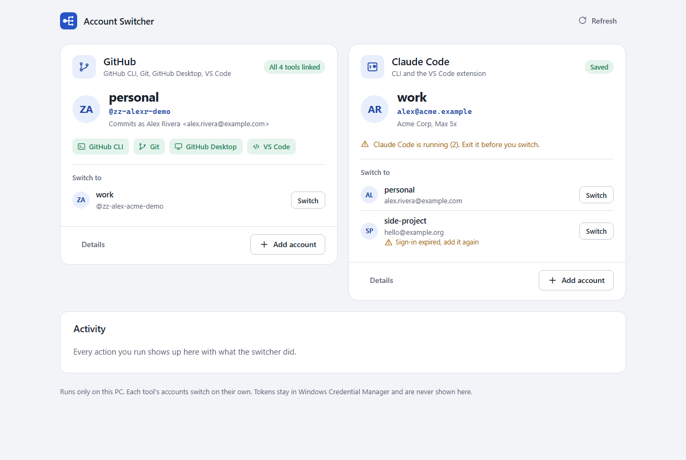

# Account Switcher for Windows

Switch the account your developer tools use, **one click per tool**, with no signing out and back in:

- **GitHub**: the GitHub CLI (`gh`), git (commit identity + Git Credential Manager), **GitHub
  Desktop** and **VS Code**, all four at once. Use multiple GitHub accounts on one Windows PC, such
  as a work and a personal account.
- **Claude Code**: the Claude Code CLI and its VS Code extension. Keep a work and a personal Claude
  account (Pro, Max, Team) and switch between them without `/login` every time.

It has a local web dashboard and a one-line CLI. More tools can be added the same way.



Each of these tools keeps its own sign-in, and none of them follows the others. Moving from a work
account to a personal one usually means signing out and back in everywhere, and signing out deletes
the saved token. This tool signs every account in once, keeps each account's sign-in safe in
Windows Credential Manager, and puts it back when you switch.

## Features

- **One dashboard**: a card per tool with the account it uses right now. GitHub shows which of
  its four tools really use the active account, with mismatches flagged.
- **One-click switch** between profiles, with a confirmation and a full log of what changed.
- **Each tool switches on its own**: work GitHub with a personal Claude account is fine.
- **One profile per account**: a GitHub username or email, or a Claude account, that already has a
  profile is refused. A profile can be deleted without touching the account or the apps.
- **Guided add-account wizards** with live sign-in status; progress survives a page refresh.
- **Nothing is ever signed out**. Tokens are backed up and restored inside Windows Credential
  Manager; app sign-ins are moved aside, never deleted. Claude Code's sign-in is saved again before
  every switch, because its tokens change as it refreshes them.
- **Local only**. A localhost server with a per-run key. Tokens are never shown, logged or sent
  anywhere.
- **Safe app handling**. VS Code and GitHub Desktop are closed normally, so unsaved-work prompts
  still appear, then reopened. Claude Code sessions are never killed: the switch waits until you
  exit them.

## How it works

```
 React UI (web/)  --HTTP + per-run key-->  lib/ui-server.ps1  (localhost:47821)
                                                 |
 switcher.ps1 (CLI) ----------------+------------+------------+
                                    |                         |
                              lib/github.ps1            lib/claude.ps1        (+ lib/common.ps1:
                                    |                         |                Credential Manager,
   gh auth switch, git config, token backups,     .claude\.credentials.json    app close/reopen)
   Desktop "Local Storage", VS Code session       .claude.json (account)
```

| Tool | Where its login lives | What a switch does |
|---|---|---|
| GitHub CLI | Credential Manager `gh:github.com:<user>` | `gh auth switch` |
| Git | Credential Manager `git:https://github.com` + global git config | Restores that account's token, sets `user.name`, `user.email` and GCM's default account |
| GitHub Desktop | `%APPDATA%\GitHub Desktop\Local Storage` + Credential Manager | Swaps in the profile's saved `Local Storage` and restores the token |
| VS Code (GitHub) | `~\.vscode-shared\sharedStorage\state.vscdb` (encrypted by VS Code) | Writes back the profile's saved, still-encrypted session |
| Claude Code | `~\.claude\.credentials.json` (tokens) + `~\.claude.json` (account) | Saves the current sign-in, then writes the profile's tokens and account back |

Full storage map, lifecycles and how to add a tool: [`readme/ARCHITECTURE.md`](./readme/ARCHITECTURE.md).

**Tech:** Windows PowerShell 5.1 with inline C# (advapi32 P/Invoke for Credential Manager), the
Python standard library (`sqlite3`, `json`), React 18 + TypeScript + Vite. The PowerShell side has no
third-party dependencies.

## Requirements

- Windows 10/11, Windows PowerShell 5.1
- Python 3 on `PATH` (standard library only), for the VS Code and Claude Code parts
- Node.js 18+, only to build the web UI once
- GitHub part: Git for Windows with Git Credential Manager, GitHub CLI `gh` 2.40+ (multi-account
  support). GitHub Desktop and VS Code are optional; each part is skipped with a warning if missing
- Claude Code part: Claude Code with a Claude subscription sign-in (`claude auth login`)

## Quick start

```powershell
git clone https://github.com/sale-shubham/account-switcher.git
cd account-switcher\web
npm install
npm run build
cd ..
.\switcher.ps1 -Ui
```

The browser opens the dashboard. Keep the PowerShell window open while you use it. Run it from a
normal PowerShell window: started from VS Code's terminal it reopens itself in its own window,
because a GitHub switch closes VS Code and everything running inside it.

**Add your accounts:** on each card, click **Add account** and follow the steps. On the Claude Code
card, **Save as profile** keeps the account you are signed in to now.

## Command line

```powershell
.\switcher.ps1                        # show every tool's current account and saved profiles
.\switcher.ps1 -Ui                    # open the web UI

.\switcher.ps1 github work            # switch gh, git, GitHub Desktop and VS Code to 'work'
.\switcher.ps1 github -Save work      # save what the GitHub tools are signed in to now as 'work'
.\switcher.ps1 github -Clear          # sign Desktop + VS Code out safely, to add another account

.\switcher.ps1 claude personal        # switch Claude Code to 'personal' (exit Claude Code first)
.\switcher.ps1 claude -Save personal  # save what Claude Code is signed in to now as 'personal'
.\switcher.ps1 claude -Clear          # sign Claude Code out safely, to add another account
```

GitHub profiles live in `accounts.json` (created by the UI, or copied from `accounts.example.json`):

```json
{
  "work":     { "name": "Your Name", "email": "you@company.com", "user": "work-login" },
  "personal": { "name": "Your Name", "email": "you@example.com", "user": "personal-login" }
}
```

Claude Code profiles need no file: they are saved from whatever Claude Code is signed in to.

> **Never sign out to switch.** "Sign out" in Desktop or VS Code, `gh auth logout`, and Claude
> Code's `/logout` or `claude auth logout` end the saved sign-in. Use the UI's **Prepare** / **Sign
> out** steps, or `-Clear`, which move it aside instead.

## FAQ

**How do I use two GitHub accounts on one Windows PC?**
Add each account once with **Add account** on the GitHub card (or `github -Save` on the command
line). After that, one **Switch** moves the GitHub CLI, git, GitHub Desktop and VS Code to the
other account.

**Does `gh auth switch` also change the account git pushes with?**
Not with Git Credential Manager, the Git for Windows default. `gh auth switch` changes only the
GitHub CLI; git keeps pushing with the account saved in Git Credential Manager, and commits keep
the old `user.name` / `user.email`. The switcher changes all three.

**How do I switch GitHub accounts in GitHub Desktop or VS Code without signing out?**
Signing out deletes the saved token, so you sign in from scratch every time. The switcher closes
the app normally, swaps in the sign-in it saved for that account, and reopens it.

**How do I switch between Claude Code accounts?**
Add each Claude account once with **Add account** on the Claude Code card (it signs Claude Code out
safely, you sign in as the next account, it saves). Then exit Claude Code and click **Switch**. New
Claude Code sessions, in the terminal and in VS Code, use the new account.

**Why does Claude Code have to be closed to switch?**
A running session keeps its sign-in in memory and writes it back when it refreshes it, which would
undo the switch. The switcher never kills it; it tells you how many sessions are still running.

**Is it safe? Where are my tokens?**
Tokens stay in Windows Credential Manager, encrypted for your Windows user. The UI runs on
localhost only, with a per-run key, and never shows a token.

**Does it work on macOS or Linux?**
No. It is built on Windows Credential Manager and the Windows app data folders.

## Not covered

- SSH keys, and GitHub Enterprise Server hosts (github.com only)
- Copilot's remembered account preference (it may ask once which account to use)
- Which account the VS Code GitHub session belongs to: VS Code encrypts it, so the UI only shows
  that one exists
- The Claude desktop app, and Claude Code with an API key instead of a subscription sign-in
- A saved Claude sign-in that expired (the UI shows the date): sign in and save it again

Full list: [`readme/ARCHITECTURE.md`](./readme/ARCHITECTURE.md), "Known limitations".

## Documentation

| Doc | Covers |
|---|---|
| [`readme/ARCHITECTURE.md`](./readme/ARCHITECTURE.md) | Where each tool stores its login, components, switch lifecycles, security, known limitations, adding a tool |
| [`readme/RESEARCH.md`](./readme/RESEARCH.md) | Existing GitHub switcher tools surveyed and why they fall short |
| [`readme/flows/`](./readme/flows/) | GitHub and Claude Code switch, save, sign-out, and the web UI, step by step |
| [`readme/methods/`](./readme/methods/) | Credential store, VS Code session, Desktop state, GitHub profiles, Claude Code state, UI server + API |
| [`PROJECT_STRUCTURE.md`](./PROJECT_STRUCTURE.md) | File tree, module map, tool versions |
| [`CLAUDE.md`](./CLAUDE.md), [`docs/DOC_SYNC.md`](./docs/DOC_SYNC.md) | How the docs are kept in sync with the code |

## License

[MIT](./LICENSE)
